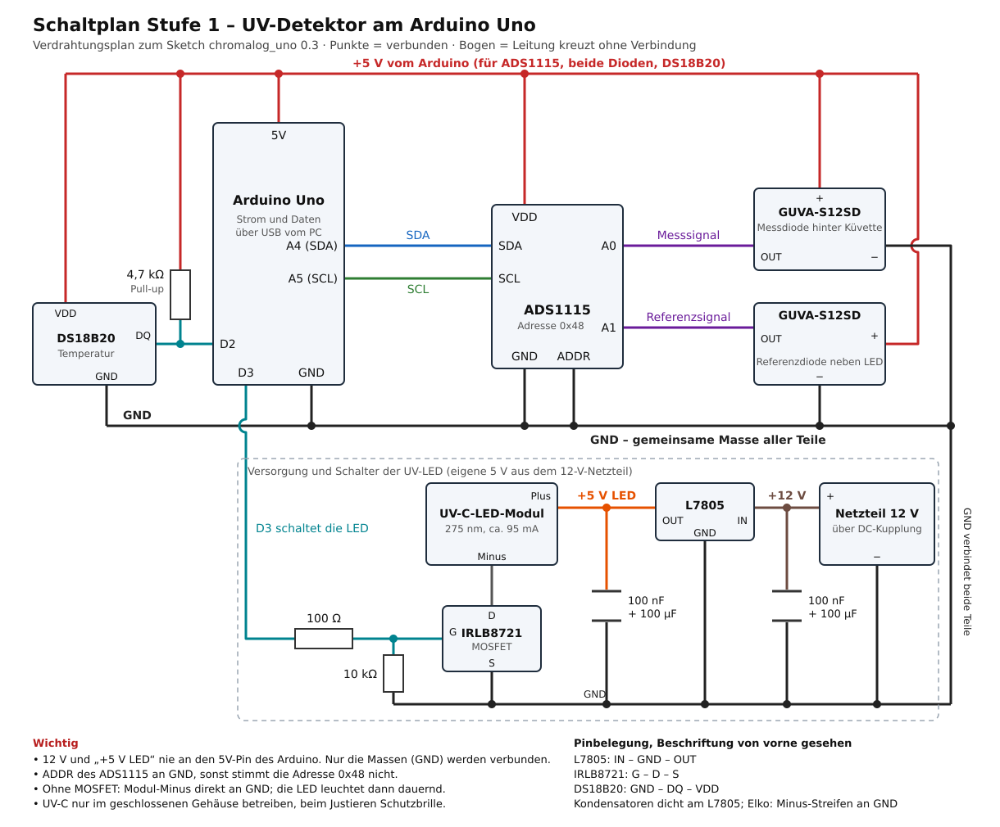

# Inbetriebnahme Stufe 1: UV-Detektor am Arduino Uno

Diese Anleitung führt vom Aufspielen des Sketches bis zur ersten Stabilitätsmessung. Sie gilt für ChromaLog ab Version 0.12 und den Sketch ab Version 0.4.

**Stand der Prüfung:** Software und Sketch sind automatisch getestet, aber nur mit nachgebildeten Geräten. Mit einem echten Arduino ist dieser Ablauf noch nicht durchgespielt. Rechne beim ersten Mal mit Kleinigkeiten und melde, was nicht passt.

**UV-C schädigt Augen und Haut.** Die LED nur im geschlossenen Gehäuse betreiben, beim Justieren die Schutzbrille tragen.

## 1 Sketch aufspielen
1. Arduino IDE öffnen. Im Bibliotheksverwalter installieren: **Servo**, **OneWire**, **DallasTemperature**, **Adafruit ADS1X15** (die Nachfrage nach „Adafruit BusIO“ bestätigen).
2. Den Ordner `firmware/chromalog_uno` aus dem Repo öffnen (Datei `chromalog_uno.ino`).
3. Board „Arduino Uno“ und den Anschluss wählen, hochladen.
4. Den seriellen Monitor der IDE schließen, sonst ist der Anschluss belegt.

## 2 Verdrahten
Schaltplan: [`schaltplan-stufe1.svg`](schaltplan-stufe1.svg) (zum Drucken auch als [`schaltplan-stufe1.png`](schaltplan-stufe1.png)).

| Signal | Arduino-Pin | Bauteil |
| --- | --- | --- |
| +5 V | 5V | ADS1115, beide UV-Sensoren, DS18B20 |
| GND | GND | gemeinsame Masse aller Teile |
| SDA / SCL | A4 / A5 | ADS1115 (ADDR an GND, Adresse 0x48) |
| Messdiode | – | GUVA-S12SD OUT → ADS1115 A0 |
| Referenzdiode | – | GUVA-S12SD OUT → ADS1115 A1 |
| LED an/aus | D3 | MOSFET-Gate über 100 Ω, dazu 10 kΩ nach GND |
| Temperatur | D2 | DS18B20 DQ, 4,7 kΩ nach +5 V |

Alle Massen verbinden. 12 V nie an den 5-V-Pin.

Ohne MOSFET leuchtet die LED dauernd; dann zählt für den Dunkelwert das Ausstecken des LED-Moduls.

## 3 Verbinden
- **Linux-PC:** ChromaLog starten (Programm oder Chrome/Chromium mit https://barneygamble332.github.io/ChromaLog/), im Reiter „Messen“ auf „Mit Arduino verbinden (USB)“ klicken und den Anschluss wählen. Erscheint kein Anschluss: `sudo usermod -a -G dialout $USER`, neu anmelden.
- **Handy:** Arduino mit USB-OTG-Adapter anstecken, in der App „Mit Arduino verbinden (USB)“ antippen und den Zugriff erlauben.

**Welcher Anschluss ist der Arduino?** Unter Linux heißt er `ttyACM0` (Original-Uno) oder `ttyUSB0` (Nachbau mit CH340-Chip); die Arduino IDE zeigt denselben Namen als `/dev/ttyACM0` bzw. `/dev/ttyUSB0`. Linux meldet daneben rund 30 alte Anschlüsse `ttyS0` bis `ttyS31`, die es am Rechner meist gar nicht gibt.
- ChromaLog bietet deshalb zuerst nur USB-Geräte an. Im Linux-Programm wird ein einzelner erkannter Arduino ohne Nachfrage genommen.
- Steht der Arduino nicht in der Liste: „Arduino nicht in der Liste? Alle Anschlüsse zeigen“ wählen.
- Fehlt er auch dort: Arduino IDE schließen, Kabel neu stecken, im Terminal `ls /dev/ttyACM* /dev/ttyUSB*` prüfen. Chromium aus dem Snap-Paket braucht einmalig `sudo snap connect chromium:raw-usb`.

Nach dem Verbinden startet der Uno neu. Unter „System“ zeigt die Geräte-Konsole dann `READY ChromaLog-Uno 0.4`. Steht dort `# ADS1115 nicht gefunden`, stimmt die Verdrahtung von A4/A5, 5 V oder GND nicht.

Im Browser und im Linux-Programm verbindet sich ChromaLog beim nächsten Start von selbst wieder mit dem zuletzt benutzten Anschluss.

## 4 Aufbau wählen
Im Reiter „Steuerung“ den Aufbau **„Stufe 1 – UV-Detektor“** wählen. Er enthält UV-LED, Autozero, Dunkelwert, Extinktion, Temperatur, die Spannungen an Mess- und Referenzdiode und den Messbereich (Verstärkung). Dieselben Bauteile erscheinen im Reiter „Messen“.

## 5 Einrichten
1. Küvette mit destilliertem Wasser einsetzen, Gehäuse schließen, „UV-LED“ auf „An“.
2. Die Spannungen ansehen und den **Messbereich** wählen. Beide Dioden sollten möglichst gut in den Bereich passen, die größere von beiden zwischen etwa der Hälfte und drei Vierteln des Bereichs:

   | Größere Diodenspannung | Messbereich |
   | --- | --- |
   | über 1,5 V | 4,096 V (×1) |
   | 0,75 – 1,5 V | 2,048 V (×2) |
   | 0,35 – 0,75 V | 1,024 V (×4) |
   | 0,18 – 0,35 V | 0,512 V (×8) |
   | unter 0,18 V | 0,256 V (×16) |

   - Am Ende des Bereichs ist der Eingang übersteuert; die Konsole meldet das. Abhilfe: einen größeren Bereich wählen, sonst kleinere Blende oder mehr Abstand.
   - Erfahrung mit dem ersten Aufbau (20.11.2026): Die UV-C-LED liefert bei 1 cm Abstand nur etwa 0,1 V. Deshalb den Lichtweg kurz halten (LED, Küvette, Messdiode dicht beieinander) und die Referenzdiode in wenigen Millimetern Abstand schräg zur LED setzen. Unter etwa 0,05 V an einer Diode bestimmt sie das Rauschen.
   - Nach dem Wechsel des Messbereichs Dunkelwert und Autozero neu setzen.
3. **Dunkelwert:** LED aus (oder Modul ausstecken), Gehäuse zu, einige Sekunden warten, „Dunkelwert“ drücken. Die Konsole bestätigt mit `# OK Dunkelwert`.
4. LED wieder an und **15 Minuten einlaufen lassen**; die LED driftet, solange sie warm wird.
5. **Autozero** drücken. Die Extinktion steht jetzt bei 0 mAU.

Bei ausgeschalteter LED zeigt ChromaLog keine Extinktion an (Strich statt Zahl). Das ist gewollt.

## 6 Stabilität messen (Testplan Schritt 2)
1. Im Reiter „Messen“ die Methode **„Detektortest (10 min, ohne Pumpe)“** wählen, als Probenname z. B. „Wasser“, Probenart „Blindwert“.
2. „Lauf starten“. Der Lauf zeichnet 10 Minuten lang einen Wert je Sekunde auf und öffnet danach die Auswertung.
3. Unter „Laufdaten“ stehen **Mittelwert**, **Rauschen**, **Drift je 10 min** und **Spanne**.

Ziele aus dem Konzept: Rauschen höchstens 1 mAU (0,001 AU), Drift höchstens 2 mAU in 10 Minuten.

Für einen Dunkeltest denselben Lauf mit ausgeschalteter LED aufnehmen; dann bleibt die Extinktion leer, aussagekräftig sind die Diodenspannungen im Reiter „Messen“.

## 7 Verdünnungsreihe (Testplan Schritt 4)
Für jede Konzentration: Küvette füllen, einsetzen, einen kurzen Lauf aufnehmen (die Detektortest-Methode duplizieren und die Laufzeit auf 1 Minute stellen), den **Mittelwert** notieren.

**Noch nicht eingebaut:** eine Kalibriergerade aus solchen Küvetten-Messungen (Mittelwert gegen Konzentration) mit Nachweisgrenze. Die vorhandene Kalibrierung im Reiter „Kalibrierung“ rechnet mit Peakflächen aus Chromatogrammen und passt für diesen statischen Test nicht.

## Wenn etwas nicht stimmt
| Beobachtung | Mögliche Ursache |
| --- | --- |
| Kein Anschluss zur Auswahl | Gruppe `dialout` fehlt, serieller Monitor der IDE noch offen, Ladekabel ohne Datenleitung |
| Verbunden, aber keine Werte | falsche Baudrate (115200), alter Sketch auf dem Arduino |
| Temperatur fehlt | DS18B20 falsch herum oder 4,7-kΩ-Widerstand fehlt |
| Extinktion bleibt leer | LED aus, oder Diodenspannung nach Abzug des Dunkelwerts nicht positiv |
| Starkes Rauschen | Netzteil, lange Leitungen, Streulicht |
| Stetige Drift | LED noch nicht warm, Temperatur ändert sich |
| Sprünge | Küvette verdreht, Fingerabdrücke, Luftblasen |
